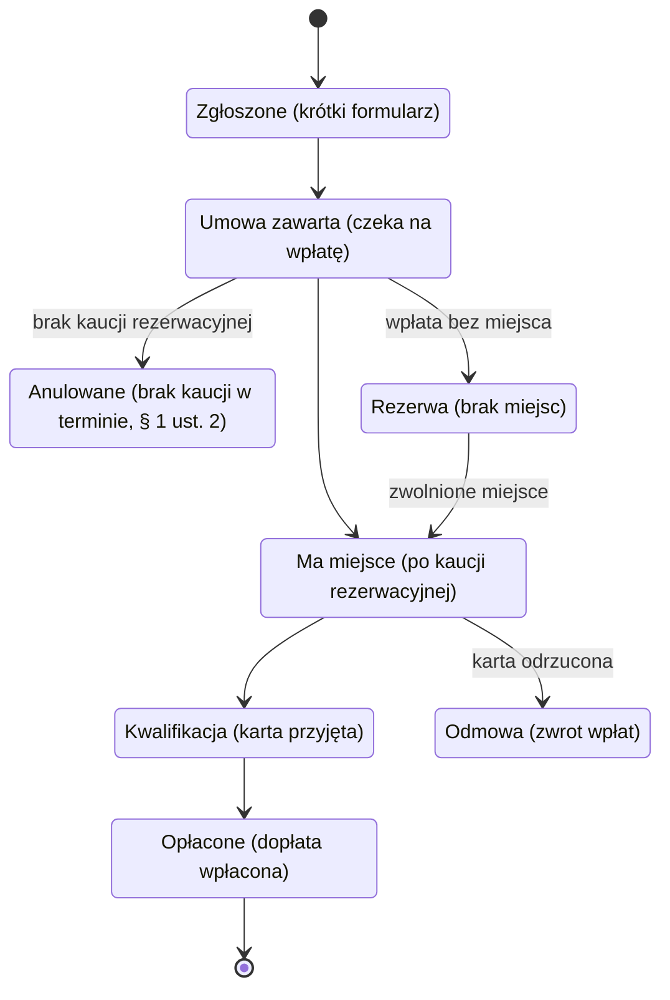

# Specyfikacja: elektroniczne zapisy na półkolonie RoboPlanet

Stan na 16.11.2026 (powrót do dotychczasowej umowy RoboPlanet jako wzoru; cena 930 zł, wiek 6 lat, terminy bez zmian)

## Cel i zakres

Rodzic zapisuje dziecko na półkolonie bez zakładania konta: wypełnia umowę i kartę kwalifikacyjną online, podpisuje je jedną z trzech metod i płaci przelewem na konto ROBOPLANET EVENTS S.C. w Erste. Biuro przestaje przepisywać dane z papieru: wszystko trafia do bazy systemu, PDF-y do pCloud, a listy do Google Sheets.

Wersja wstępna, do komentowania. Budujemy osobną aplikację z własną bazą, w tym samym stosie co zapisy.roboplanet.pl; obecny system zostaje bez zmian.

**W zakresie pierwszej wersji (MVP):**

- turnusy półkolonii z limitem miejsc i minimalnym wiekiem 6 lat (sprawdzanym z PESEL),
- krótkie zgłoszenie na stronie i pełny formularz pod linkiem z e-maila,
- generowanie umowy i karty (nowy wzór z Dz.U. 2026 poz. 704) jako PDF,
- trzy ścieżki podpisu: podpis zaufany, podpis na ekranie z kodem e-mail, wydruk,
- kaucja rezerwacyjna 200 zł i dopłata przelewem, wykrywanie wpłat z Alerty24 Erste, przypomnienia e-mail,
- akceptacja karty przez biuro (część III karty),
- lista rezerwowa, panel biura, eksport do Google Sheets, archiwum PDF w pCloud.

**Poza zakresem:**

- kolonie wyjazdowe (inne pola karty, zgłoszenia do TFG),
- płatności przez bramkę (PayU),
- faktury (wystawiane ręcznie poza systemem),
- części IV–VI karty (wypełniane na papierze przez kadrę),
- konta dla wychowawców,
- wersja angielska.

**Pierwszy sezon: ferie zimowe 2027.** Zapisy startują w poniedziałek 16.11.2026. Daty wynikają z reguł z sekcji Płatności i Miejsca i e-maile.

| Termin | Turnus I | Turnus II |
| --- | --- | --- |
| Turnus (pn–pt) | 1–5.02.2027 | 8–12.02.2027 |
| Godziny | 7:45–16:30 | 7:45–16:30 |
| Miejsce wypoczynku | ul. Marusarzówny 2/39, 80-288 Gdańsk | ul. Marusarzówny 2/39, 80-288 Gdańsk |
| Limit miejsc | 20 | 20 |
| Cena / ze zniżką | 930 zł / 880 zł | 930 zł / 880 zł |
| Kaucja rezerwacyjna / dopłata (ze zniżką) | 200 zł / 730 zł (680 zł) | 200 zł / 730 zł (680 zł) |
| Zwrot przy rezygnacji po terminie dopłaty, 50% (ze zniżką) | 465 zł (440 zł) | 465 zł (440 zł) |
| Minimalny wiek w dniu startu | 6 lat | 6 lat |
| Start zapisów | 16.11.2026 | 16.11.2026 |
| Informacja o dopłacie (21 dni przed) | 11.01.2027 | 18.01.2027 |
| Termin dopłaty (14 dni przed) | 18.01.2027 | 25.01.2027 |
| Od tego dnia zapis = cała kwota w 3 dni | 19.01.2027 | 26.01.2027 |
| Lista zaległości dla biura (7 dni przed) | 25.01.2027 | 1.02.2027 |
| Informacje praktyczne, przypomnienie o oryginałach (3 dni przed) | 29.01.2027 | 5.02.2027 |

Cena 930 zł i minimalny wiek 6 lat potwierdzone przez organizatora 13.11.2026; godziny z [roboplanet.pl/en/day-camp](https://roboplanet.pl/en/day-camp/).

## Przebieg zapisu

Od kliknięcia na roboplanet.pl do potwierdzonego miejsca rodzic przechodzi siedem kroków, a miejsce dostaje dopiero po wpłacie kaucji rezerwacyjnej.

1. **Krótkie zgłoszenie.** Przycisk na roboplanet.pl prowadzi do formularza: wybór turnusu (I, II…), imię i nazwisko rodzica, e-mail, telefon, imię dziecka, checkbox „uczestnik zajęć RoboPlanet / poprzednich edycji”, zgoda RODO. Formularz pokazuje licznik „zostało X miejsc”.
2. **Indywidualna umowa i karta.** Z danych krótkiego zgłoszenia system generuje komplet dla tego jednego zgłoszenia: wybrany turnus z datami i adresem, kwotę (cena minus ewentualna zniżka, kaucja rezerwacyjna, dopłata z terminami), kod zgłoszenia, dane już podane przez rodzica. Wysyła link do pełnego formularza; kliknięcie potwierdza adres e-mail.
3. **Pełny formularz.** Rodzic uzupełnia brakujące dane umowy i karty w kilku krokach, z możliwością zapisania i powrotu przez ten sam link. Na końcu ekran podsumowania przed podpisem: cena i jej składniki, terminy wpłat, zasady rezygnacji (§ 2 umowy), skutek braku kaucji (anulowanie, § 1 ust. 2), informacja, że ustawowe prawo odstąpienia w 14 dni nie przysługuje (art. 38 ust. 1 pkt 12 ustawy o prawach konsumenta; tej informacji nie ma w umowie, więc pokazuje ją formularz), dane organizatora i sposób składania reklamacji. Bez wzoru formularza odstąpienia. Pod nim podgląd obu dokumentów jako PDF.
4. **Data zawarcia umowy.** Przy podpisie elektronicznym: dzień wysłania podpisanego formularza. Przy wydruku: dzień wgrania podpisanego skanu. Data trafia do treści umowy.
5. **Podpis.** Umowę podpisuje osoba zawierająca umowę (rodzic/opiekun prawny), jak w dotychczasowej umowie. Sposób podpisu do wyboru:
   1. podpis zaufany: pobranie PDF, podpis na gov.pl, wgranie pliku z powrotem,
   2. podpis na ekranie: narysowanie podpisu i potwierdzenie kodem wysłanym e-mailem,
   3. wydruk: rodzic pobiera wypełniony PDF, podpisuje odręcznie i **wgrywa skan lub zdjęcie** obu dokumentów. Bez skanu umowa nie jest zawarta, a oryginały rodzic przynosi pierwszego dnia turnusu.
6. **Dane do przelewu.** Ekran i e-mail z kwotą kaucji rezerwacyjnej, numerem konta Erste i tytułem z kodem zgłoszenia. Termin: 7 dni od zawarcia umowy. Przy zapisie później niż 14 dni przed startem: cała kwota, termin 3 dni.
7. **Miejsce i kwalifikacja.** Po wykryciu kaucji rezerwacyjnej rodzic dostaje potwierdzenie miejsca. Biuro czyta kartę i klika „Kwalifikuję”. 14 dni przed startem mija termin dopłaty, z przypomnieniem.

Zmianę danych po wysłaniu formularza rodzic zgłasza e-mailem, a wprowadza ją biuro w panelu.

## Pola formularzy

Rodzic wpisuje każdą daną raz; system rozkłada ją na umowę, kartę i arkusze. Numeracja w kolumnie „Trafia do” odpowiada nowemu wzorowi karty z [Dz.U. 2026 poz. 704](https://dziennikustaw.gov.pl/DU/2026/704), obowiązującemu od 6 czerwca 2026. Część I karty (forma: półkolonia, termin od–do, adres) system wypełnia sam z danych turnusu.

**Krótkie zgłoszenie:** turnus, imię i nazwisko rodzica, e-mail, telefon, imię dziecka, zgoda RODO.

**Pełny formularz:**

| Krok | Pole | Trafia do | Wymagane | Walidacja / uwagi |
| --- | --- | --- | --- | --- |
| Rodzic | Imię i nazwisko rodzica zawierającego i podpisującego umowę | umowa, karta II.2 | tak | z krótkiego zgłoszenia, do edycji |
| Rodzic | Drugi rodzic: imię i nazwisko | karta II.2 | nie | wzór karty wymienia imiona i nazwiska rodziców; drugi rodzic nie podpisuje |
| Rodzic | Adres zamieszkania lub pobytu rodziców | umowa, karta II.6 | tak | kod pocztowy NN-NNN |
| Rodzic | PESEL osoby zawierającej umowę | umowa | tak | suma kontrolna; szyfrowany jak PESEL dziecka; tylko w PDF umowy, nie w arkuszach |
| Rodzic | Telefony rodziców dostępne w czasie turnusu | umowa, karta II.7 | tak | min. jeden; drugi opcjonalnie |
| Rodzic | E-mail | umowa | tak | z krótkiego zgłoszenia |
| Dziecko | Imię (imiona) i nazwisko | umowa, karta II.1 | tak |  |
| Dziecko | PESEL | umowa, karta II.4 | tak | suma kontrolna i poprawna data; z PESEL system wylicza datę urodzenia (umowa: „Data urodzenia, nr PESEL”; zakładka Ubezpieczenie), rok urodzenia (karta II.3) i wiek. Formularz nie ma osobnego pola daty urodzenia |
| Dziecko | Adres zamieszkania | umowa, karta II.5 | tak | checkbox „taki sam jak rodziców” |
| Dziecko | Wiek | — | — | wyliczany z PESEL; min. 6 lat w dniu rozpoczęcia turnusu, inaczej blokada |
| Zdrowie | Specjalne potrzeby edukacyjne (niepełnosprawność, niedostosowanie społeczne) | karta II.8 | nie | pole tekstowe |
| Zdrowie | Uczulenia: leki, pyłki, pokarmy, jad owadów | karta II.9, arkusz wychowawcy | nie | checkboxy + opis |
| Zdrowie | Choroba lokomocyjna, choroby przewlekłe | karta II.9 | nie |  |
| Zdrowie | Leki przyjmowane na stałe i dawki | karta II.9, arkusz wychowawcy | nie | lista: lek, dawka, pora |
| Zdrowie | Aparat ortodontyczny, okulary, soczewki | karta II.9 | nie | checkboxy |
| Zdrowie | Dieta (np. niskokaloryczna, wegetariańska, bez glutenu) | karta II.9, arkusz wychowawcy | nie | lista wyboru + opis |
| Zdrowie | Problemy z wyrażaniem emocji, z funkcjonowaniem w grupie | karta II.9, arkusz wychowawcy | nie | tak / nie + opis |
| Zdrowie | Lęk wysokości, hydrofobia | karta II.9 | nie | checkboxy |
| Zdrowie | Inne istotne informacje o zdrowiu i rozwoju | karta II.9 | nie | pole tekstowe |
| Zdrowie | Szczepienia: tężec, błonica, inne (z rokiem) | karta II.9 | nie | albo oświadczenie o książeczce zdrowia |
| Odbiór | Osoby upoważnione: imię, nazwisko, telefon | arkusz wychowawcy | nie | do 4 osób |
| Odbiór | Zgoda na samodzielny powrót | arkusz wychowawcy | tak | tak / nie |
| Odbiór | Godzina przyprowadzania i odbioru | arkusz wychowawcy | tak | w godzinach turnusu |
| Zgody | Zdjęcia w trakcie półkolonii i ich wykorzystanie marketingowe | umowa § 5 | — | w dotychczasowej umowie zgoda jest częścią treści umowy, bez osobnego checkboxu; zdjęcia wykorzystuje ROBOPLANET EVENTS S.C. |
| Zgody | Akceptacja umowy i oświadczenia rodzica | umowa | tak |  |
| Zgody | Klauzula RODO i zgoda na dane o zdrowiu | karta | tak | zgoda wyraźna, art. 9 RODO |

Szczegółowe pola zdrowia składają się w jeden czytelny opis w punkcie II.9 karty; podpis pod częścią II: „podpis rodziców / pełnoletniego uczestnika”, jak we wzorze.

PESEL rodzica jest zbierany, bo wymaga go dotychczasowa umowa.

## Statusy zgłoszenia

Zgłoszenie przechodzi pięć statusów głównych i ma trzy boczne zakończenia; każde przejście trafia do dziennika zdarzeń.

Rezygnację rodzic zgłasza e-mailem; biuro oznacza ją w panelu przy dowolnym statusie, z datą otrzymania e-maila. Zasady zwrotu według § 2 umowy: rezygnacja po terminie dopłaty, po wpłacie całości, przed startem = zwrot 50% ceny; po rozpoczęciu turnusu = brak zwrotu. Rezygnacji przed terminem dopłaty umowa nie reguluje: kwotę zwrotu wpisuje biuro (świadoma decyzja z 16.11.2026). Status dokumentów (podpisane elektronicznie / podpisane skanem) jest osobnym polem, niezależnym od tej ścieżki.

**Brak kaucji.** Zgodnie z § 1 ust. 2 brak terminowej wpłaty kaucji oznacza anulowanie zgłoszenia. Po terminie system przenosi zgłoszenie na listę „Do wyjaśnienia”, a biuro jednym kliknięciem anuluje je i wysyła e-mail do rodzica. Wpłata, która wpłynie przed anulowaniem, je wstrzymuje.

**Brak dopłaty.** Umowa nie określa skutku. Zgłoszenie bez dopłaty po terminie trafia na listę „Do wyjaśnienia” i biuro decyduje ręcznie.

## Dokumenty i podpis

Każde zgłoszenie dostaje dwa PDF-y, umowę i kartę, wygenerowane z wersjonowanego szablonu; system zapisuje, którą wersję rodzic podpisał i jaki był skrót (SHA-256) pliku.

**Generowanie PDF.** System nie ma dziś biblioteki do PDF-ów, więc to nowa zależność. Propozycja: `pdf-lib` (czysty JavaScript, działa w funkcjach Vercel, bez przeglądarki). Szablon umowy i karty składany w kodzie, z polskimi znakami (osadzona czcionka). Na umowie i w części I karty: skan podpisu wspólnika spółki Events i skan pieczątki.

**Wersje szablonów.** Treść umowy i karty ma numer wersji i datę obowiązywania. Zmiana treści = nowa wersja; stare zgłoszenia zostają przy swojej.

**Trzy ścieżki podpisu:**

| Ścieżka | Co robi rodzic | Co zapisuje system | Status dokumentów |
| --- | --- | --- | --- |
| Podpis zaufany (domyślna) | pobiera PDF, podpisuje na gov.pl (PAdES), wgrywa plik | podpisany plik, sprawdzenie, że zawiera podpis elektroniczny i że treść zgadza się z wygenerowaną | podpisane elektronicznie |
| Podpis na ekranie | rysuje podpis, wpisuje 6-cyfrowy kod z e-maila (ważny 10 min) | obraz podpisu nałożony na PDF, czas, IP, przeglądarka, skrót PDF, potwierdzenie kodu | podpisane elektronicznie |
| Wydruk | pobiera wypełniony PDF, podpisuje odręcznie, wgrywa skan lub zdjęcie, przynosi oryginały 1. dnia | skan (biuro sprawdza czytelność i podpisy), data wgrania = data zawarcia umowy | podpisane skanem |

Rodzic, który zaczął od podpisu zaufanego i utknął, może zmienić ścieżkę. Próby wpisania kodu są dławione tym samym mechanizmem co logowanie administratora.

**Akceptacja karty (część III).** Biuro czyta kartę w panelu i klika „Kwalifikuję” albo „Odmawiam” z uzasadnieniem. System dokłada do PDF karty decyzję, datę, podpis i pieczątkę organizatora. Odmowa = pełny zwrot wpłat i zwolnienie miejsca.

Gotowe PDF-y trafiają do pCloud, a rodzic dostaje kopię e-mailem.

## Płatności

Rodzic płaci zwykłym przelewem na konto ROBOPLANET EVENTS S.C. w Erste; system sam wykrywa wpłaty z e-maili Alerty24 i nie wysyła przypomnień osobom, które zapłaciły.

**Kwoty** (w groszach, jak w całym systemie):

| Składnik | Wartość | Termin |
| --- | --- | --- |
| Cena turnusu | ustawiana per turnus (ferie 2027: 930 zł) | — |
| Zniżka stałego uczestnika | −50 zł | przy zaznaczonym checkboxie |
| Kaucja rezerwacyjna | 200 zł | 7 dni od zawarcia umowy |
| Dopłata | cena − zniżka − kaucja rezerwacyjna | 14 dni przed startem turnusu |
| Całość (późny zapis) | cena − zniżka | 3 dni, gdy zapis < 14 dni przed startem |
| Zwrot przy rezygnacji (§ 2) | po terminie dopłaty: 50% ceny (465 / 440 zł); od startu: 0 | według daty e-maila rezygnacji |

**Tytuł przelewu.** Każde zgłoszenie ma kod, np. `RP-Z27-0142` (sezon + numer). Tytuł: `RP-Z27-0142 Imię Nazwisko dziecka`. Kod jest kluczem dopasowania; imię pomaga przy ręcznym sprawdzeniu.

**Wykrywanie wpłat, w kolejności ważności:**

1. **Alerty24 e-mail.** Erste wysyła alert o każdym wpływie (próg 0 zł) na skrzynkę `wplaty@roboplanet.pl` (hosting UTI.PL). System czyta ją przez IMAP w codziennym zadaniu tuż przed przypomnieniami oraz przy otwarciu listy turnusu. Przyjmuje tylko wiadomości z poprawnym podpisem DKIM domeny banku. Format alertu opisany niżej, ustalony na przelewie testowym z 13.11.2026.
2. **Przycisk „Już zapłaciłem”** w e-mailach. Zmienia status na „wpłata zgłoszona” i wstrzymuje przypomnienia na 3 dni robocze; potem sprawa trafia do biura.
3. **Import CSV z Erste** w panelu: zapas i okresowa kontrola. Ten sam mechanizm dopasowania, duplikaty pomijane.
4. **Ręczne oznaczenie** wpłaty przez biuro, z notatką.

**Format alertu Alerty24 („Wpływ na konto”):**

| Element | Wartość w przykładzie | Jak czytać |
| --- | --- | --- |
| Nadawca | `Alerty24 <alerty24@erste.pl>` | przyjmowany tylko z poprawnym podpisem DKIM `d=erste.pl` (w przykładzie selektor `protectpl2`, podpis obejmuje treść wiadomości); domena ma DMARC `p=REJECT` |
| Temat | `Alerty24: Wpływ na konto` | inne tematy pomijane |
| Treść | tylko HTML, nagłówek `charset=UTF-8` (znacznik `meta` w HTML błędnie mówi ISO-8859-2) | dekodować według nagłówka MIME |
| Tytuł | etykieta `Tytuł:`, wartość w `<b>` | szukać kodu `RP-Z27-NNNN` bez względu na wielkość liter i spacje |
| Od kogo | etykieta `Od kogo:` | nazwa nadawcy, bez numeru jego konta |
| Ile | `1,00 PLN` | przecinek dziesiętny; separator tysięcy może być spacją lub spacją nierozdzielającą; zamiana na grosze |
| Na konto | numer konta odbiorcy | przyjmować tylko wpływy na konto organizatora |
| Saldo | stan konta po przelewie | **nie zapisywać** |
| Identyfikator | `Identyfikator wiadomości: …` w stopce i `Message-ID` | klucz przeciw duplikatom |

Data wpływu = nagłówek `Date`. Alert nie podaje numeru konta nadawcy ani identyfikatora transakcji bankowej. Do sprawdzenia drugim przelewem testowym: tytuł w formacie `RP-Z27-0001 Imię Nazwisko` z polskimi znakami oraz bardzo długi tytuł (czy bank go nie obcina).

**Przypadki brzegowe** (trafiają na listę „Do wyjaśnienia”):

- brak kodu w tytule: system podpowiada zgłoszenia po kwocie i nazwisku, biuro zatwierdza,
- jedna wpłata za rodzeństwo: biuro dzieli ją na zgłoszenia,
- niedopłata: zgłoszenie zostaje nieopłacone, przypomnienie o brakującej kwocie,
- nadpłata lub wpłata po zapełnieniu turnusu: do zwrotu albo lista rezerwowa,
- zwroty (odmowa kwalifikacji, brak miejsc, odwołanie turnusu, rezygnacja według § 2 umowy) wykonuje biuro w banku w 14 dni; system liczy kwotę i je odnotowuje.

## Miejsca i e-maile

Miejsce przydziela wpłata kaucji rezerwacyjnej, w kolejności wpłat; formularz bez wpłaty niczego nie blokuje.

**Miejsca i lista rezerwowa:**

- licznik „zostało X miejsc” = limit turnusu minus zgłoszenia z wpłaconą kaucją rezerwacyjną (lub całością),
- gdy w trakcie zapisu jest więcej osób niż wolnych miejsc, formularz ostrzega: „miejsca przydzielamy według kolejności wpłat”,
- wpłata po zapełnieniu turnusu = lista rezerwowa i e-mail z wyborem: zwrot albo czekanie,
- zwolnione miejsce (rezygnacja, odmowa, wygaśnięcie) proponowane pierwszej osobie z listy, z terminem 2 dni na potwierdzenie,
- brak kaucji w terminie: anulowanie zgłoszenia (§ 1 ust. 2), brak dopłaty: decyzja biura (sekcja Statusy).

**Harmonogram wiadomości:**

| Kiedy | Wiadomość | Do kogo |
| --- | --- | --- |
| Po krótkim zgłoszeniu | link do pełnego formularza | rodzic |
| 2 dni bez wypełnienia formularza | przypomnienie z linkiem | rodzic |
| Po wysłaniu formularza | potwierdzenie, PDF-y, dane do przelewu, przycisk „Już zapłaciłem” | rodzic |
| 5. dzień bez kaucji rezerwacyjnej | przypomnienie o kaucji rezerwacyjnej | rodzic |
| 7. dzień bez kaucji rezerwacyjnej | „do decyzji” | biuro |
| Po wykryciu kaucji rezerwacyjnej | potwierdzenie miejsca | rodzic |
| Po decyzji o karcie | zakwalifikowanie albo odmowa ze zwrotem | rodzic |
| 21 dni przed startem | informacja o dopłacie i terminie | rodzic |
| 14 dni przed startem, brak dopłaty | przypomnienie | rodzic |
| Po anulowaniu przez biuro (brak kaucji) | informacja o anulowaniu zgłoszenia | rodzic |
| 7 dni przed startem, brak dopłaty | lista zaległości | biuro |
| 3 dni przed startem | praktyczne informacje; przy ścieżce wydruku: „przynieś oryginały” | rodzic |

Wszystkie treści edytowalne w panelu (jak dziś w `Setting`). Liczby dni do potwierdzenia: 2, 21, 7 i 3 to propozycje.

## Panel biura, Google Sheets i pCloud

Biuro pracuje w panelu systemu; Google Sheets to kopia do sortowania i druku, a pCloud to archiwum PDF-ów.

**Panel biura (`polkolonie.roboplanet.pl/admin`):**

- turnusy: tworzenie, cena, limit, daty, godziny, wersje szablonów,
- lista turnusu: dziecko, status, ścieżka podpisu, wpłaty, decyzja o karcie,
- karta do przeczytania i przyciski „Kwalifikuję” / „Odmawiam”,
- „Do wyjaśnienia”: wpłaty bez dopasowania, „Już zapłaciłem” bez wpływu, kaucji rezerwacyjnej po terminie,
- import CSV z Erste, ręczne oznaczenie wpłaty, odnotowanie zwrotu,
- edycja danych na prośbę rodzica: każda zmiana w dzienniku (kto, kiedy, co było, co jest),
- odbiór papierowych dokumentów 1. dnia.

**Google Sheets:** jeden arkusz na sezon, zakładka na każdy turnus, odświeżany automatycznie po każdej zmianie. Arkusz jest tylko do odczytu: zmiany wpisane w nim nie wracają do systemu.

| Zakładka | Kolumny | Dla kogo |
| --- | --- | --- |
| Zgłoszenia | kod, dziecko, rodzic, telefon, status, ścieżka podpisu, kaucja rezerwacyjna, dopłata, zniżka | biuro |
| Ubezpieczenie | imię i nazwisko, data urodzenia (z PESEL) | ubezpieczyciel |
| Lista 1. dnia | imię i nazwisko, ☐ karta, ☐ umowa (wstępnie zaznaczone przy podpisie elektronicznym) | druk na 1. dzień |
| Wychowawca | imię i nazwisko, uwagi: zachowanie, leki, dieta, osoby do odbioru, samodzielny powrót, godziny | druk dla wychowawcy |

PESEL i adresy nie trafiają do arkusza. Dostęp: Ty i Estera; wychowawcy dostają tylko wydruk.

**pCloud:** folder `RoboPlanet/Polkolonie/<sezon>/<turnus>/`, pliki `<kod>_umowa_v<wersja>.pdf`, `<kod>_karta.pdf`, `<kod>_umowa_podpisana.pdf`. Połączenie przez API pCloud (OAuth). Region danych UE potwierdzony; umowa powierzenia otwarta.

## Model danych

Półkolonie działają jako osobna aplikacja (roboczo polkolonie.roboplanet.pl) z własną bazą Neon, w tym samym stosie co zapisy.roboplanet.pl: Next.js 16, Prisma 7, Vercel. Obecny system zostaje bez zmian, a dane o zdrowiu i PESEL-e są od niego odizolowane.

| Model | Po co | Najważniejsze pola |
| --- | --- | --- |
| `Organizer` | organizator i dane do umowy | ROBOPLANET EVENTS S.C., NIP 957-113-76-36, adres, konto Erste, skan podpisu wspólnika, skan pieczątki |
| `Turnus` | turnus | numer (I, II…), daty (północ UTC), godziny, adres, limit, min. wiek 6, cena, kaucja rezerwacyjna 200 zł, zniżka 50 zł, wersje szablonów |
| `Application` | zgłoszenie | kod `RP-Z27-0142`, status, dane rodzica i dziecka, PESEL (szyfrowany; data urodzenia i wiek wyliczane z niego, nie zapisywane osobno), oświadczenie o drugim rodzicu, zdrowie (szyfrowane), zgody, zniżka, data zawarcia umowy, ścieżka podpisu, decyzja o karcie, skrót tokenu linku, pozycja na liście rezerwowej |
| `DocumentTemplate` | treść umowy i karty | rodzaj, wersja, data obowiązywania, skrót treści |
| `Document` | wygenerowany, podpisany lub zeskanowany PDF | zgłoszenie, rodzaj, wersja szablonu, SHA-256, id pliku w pCloud |
| `Signature` | dowód podpisu | metoda, czas, IP, przeglądarka, potwierdzenie kodu, skrót wgranego pliku |
| `Charge` | należność | kaucja rezerwacyjna / dopłata / całość, kwota w groszach, termin, zapłacono |
| `BankTransaction` | wpływ z banku | źródło (alert / CSV / ręcznie), data, kwota, tytuł, nadawca, skrót (unikalny, przeciw duplikatom), status dopasowania |
| `Allocation` | przypisanie wpływu do należności | transakcja, należność, kwota (rodzeństwo w jednym przelewie) |
| `Event` | dziennik zdarzeń | zgłoszenie, kto, co, przed, po, kiedy |
| `AdminUser` | jedno konto administratora | e-mail, skrót hasła (bcrypt), drugi składnik logowania (kod z aplikacji) |

**Architektura i zależności:**

- osobne repozytorium, projekt Vercel i baza Neon; od początku z gałęzią testową bazy i podglądami Vercel, żeby testy nie dotykały prawdziwych zgłoszeń,
- wspólna z obecnym systemem jest tylko domena roboplanet.pl (nowa subdomena); poczta przez osobnego użytkownika SMTP (zasady w sekcji Izolacja od zapisy.roboplanet.pl),
- brak powiązania z `Client`/`Student`; gdyby kiedyś było potrzebne, przez prosty interfejs między aplikacjami,
- te same zasady co w zapisach, napisane od nowa w tym repozytorium na podstawie tej specyfikacji (bez kopiowania kodu z zapisów), każda w jednym miejscu: daty dzienne jako północ UTC, dławienie prób, kwoty w groszach, nazwane predykaty statusów,
- nowe zależności (propozycja): `pdf-lib` (PDF), `imapflow` + `mailauth` (odczyt alertów i DKIM), Google Sheets API, pCloud API.

## Bezpieczeństwo i RODO

Moduł przetwarza dane o zdrowiu dzieci, więc każde wejście jest uwierzytelnione, a dane szczególne są szyfrowane i nie wychodzą poza bazę aplikacji, pCloud i jedną zakładkę arkusza.

- **Jedno konto administratora** ma dostęp do panelu i danych; innych kont i ról nie ma. Logowanie: e-mail, hasło i kod z aplikacji uwierzytelniającej, bo w bazie są dane o zdrowiu dzieci. Każda akcja panelu zaczyna się od jednej wspólnej funkcji sprawdzającej sesję tego konta; żadna akcja nie ma własnej kopii tego sprawdzenia.
- **Link rodzica** to losowy token (w bazie tylko jego skrót), ważny do startu turnusu, przypisany do jednego zgłoszenia. Po zawarciu umowy link pokazuje tylko podgląd i status, bez edycji.
- **Publiczne formularze** dławione tak jak logowanie administratora; krótkie zgłoszenie z ochroną przed botami.
- **Alerty bankowe** przyjmowane tylko z poprawnym DKIM banku; hasło do skrzynki, klucze pCloud i Google tylko w zmiennych środowiskowych.
- **Szyfrowanie** PESEL i danych o zdrowiu w bazie własnym kluczem aplikacji; PESEL i adresy nie trafiają do Sheets.
- **Izolacja:** osobna baza i osobne wdrożenie, więc błąd w półkoloniach nie dotyka danych rodzin z zajęć i odwrotnie.
- **Dziennik zdarzeń** dla każdego zgłoszenia: zmiany danych, podpisy, wpłaty, decyzje.
- **Podstawy prawne:** umowa (art. 6 ust. 1 lit. b), obowiązek prawny przy karcie (lit. c), wyraźna zgoda na dane o zdrowiu (art. 9 ust. 2 lit. a), osobne zgody na zdjęcia i marketing.
- **Podmioty przetwarzające:** Neon, Vercel, Google, pCloud, UTI.PL; z każdym umowa powierzenia i wpis w klauzuli informacyjnej.
- **Polityka prywatności** na roboplanet.pl (ostatnia zmiana 2021) nie obejmuje półkolonii: wymienia innych administratorów, nie mówi o danych o zdrowiu, deklaruje brak udostępniania danych firmom zewnętrznym i przechowywanie do 10 lat. Formularze pokazują więc osobną klauzulę informacyjną ROBOPLANET EVENTS S.C., a politykę na stronie trzeba uzupełnić.

**Przechowywanie danych: najkrótszy możliwy czas, usuwanie automatyczne:**

| Dane | Jak długo | Uzasadnienie |
| --- | --- | --- |
| Krótkie zgłoszenie bez zawartej umowy | 30 dni od wygaśnięcia linku lub umowy | brak umowy, tylko obsługa zapytania |
| Dane o zdrowiu, osoby do odbioru, uwagi dla wychowawcy (baza i zakładki turnusu w Sheets) | 30 dni po końcu turnusu | potrzebne tylko w trakcie turnusu i na wyjaśnienie zdarzeń zaraz po nim |
| Podpisana karta kwalifikacyjna (PDF lub skan w pCloud, oryginał papierowy) | 5 lat od końca roku, w którym odbył się turnus | dokumentacja wypoczynku, wymóg 5 lat; liczenie od końca roku obejmuje też 5 lat od usunięcia zgłoszenia z bazy wypoczynku |
| Umowa, wpłaty, zwroty | 5 lat od końca roku podatkowego | obowiązki podatkowe i rachunkowe; obejmuje też przedawnienie roszczeń |
| Dziennik zdarzeń | razem z umową | dowód podpisu i zmian |

System usuwa dane w codziennym zadaniu i zapisuje w dzienniku, co usunął i kiedy.

Przed startem warto zrobić krótki przegląd bezpieczeństwa modułu na wzór audytu z września 2026.

## Izolacja od zapisy.roboplanet.pl

Nowa aplikacja nie może zmienić systemu zajęć, bo nie dostaje do niego żadnego dostępu: ani kodu, ani bazy, ani wdrożenia, ani haseł. Te zasady obowiązują na każdym etapie, także przy pracy agenta budującego system.

| Zasób | Ryzyko | Zasada |
| --- | --- | --- |
| Baza danych | migracja wykonana na bazie zajęć (usuwające migracje już dwa razy położyły stronę) | osobny **projekt** w Neon, nie gałąź w projekcie zajęć; `DATABASE_URL` zapisów nigdy nie trafia do tej aplikacji ani do sesji agenta; testy i `migrate dev` na lokalnym PostgreSQL w sesji |
| GitHub | dostęp agenta do repozytorium zapisów | aplikacja Claude na GitHubie zainstalowana z opcją „Only select repositories”, tylko na repozytorium `polkolonie`; do sesji podłączone tylko ono; push na osobną gałąź, nie na main |
| Vercel | zmiana domen lub zmiennych w projekcie zapisów | osobny projekt Vercel; agent nie dostaje dostępu do Vercel, wdrożenie startuje po pushu |
| Domena | zmiana istniejących rekordów DNS roboplanet.pl | jeden nowy rekord dla subdomeny `polkolonie`, dodany ręcznie w panelu UTI.PL; żadnych edycji ani usunięć |
| Poczta (SMTP) | błąd w wysyłce wyczerpuje limit hostingu i blokuje e-maile zapisów | osobny użytkownik SMTP (np. `polkolonie@roboplanet.pl`); limit wysyłki w aplikacji poniżej dziennego limitu hostingu |
| Sekrety | wyciek lub pomyłkowe użycie haseł zapisów | żadne hasła ani klucze zapisów nie trafiają do tej aplikacji, repozytorium ani rozmowy z agentem |

**Kontrola przed każdym etapem:** agent wypisuje wszystkie zewnętrzne zasoby, których używa (repozytoria, bazy, projekty Vercel, domeny, konta e-mail, klucze API), i potwierdza, że żaden nie należy do zapisy.roboplanet.pl. Jeśli pojawi się cokolwiek z zapisów, prace stają do wyjaśnienia.

## Umowa i karta

Wzory są w projekcie: `umowa-wzor.md` (wersja 5 z 16.11.2026) i `claude/karta-kwalifikacyjna-wzor.md` (nowy wzór z Dz.U. 2026 poz. 704). Pola `{{…}}` i warianty opisuje komentarz na końcu każdego pliku.

Umowa to dotychczasowa umowa RoboPlanet (§ 1–7 i oświadczenie rodzica) z nowymi danymi organizatora (ROBOPLANET EVENTS S.C., konto Erste), ceną i terminami: kaucja 200 zł w 7 dni od zawarcia, dopłata 14 dni przed startem, przy późnym zapisie całość w 3 dni. Tytuł przelewu z kodem zgłoszenia. Pozostałe zapisy bez zmian. Poprzednia, rozbudowana wersja (4) jest w `claude/archiwum/umowa-wzor-v4.md`.

Decyzje z 16.11.2026: § 4 ust. 2 dopuszcza wypełnienie elektroniczne; w § 5 zdjęcia wykorzystuje ROBOPLANET EVENTS S.C.; rezygnacja przed terminem dopłaty i brak dopłaty zostają nieuregulowane (biuro decyduje ręcznie). Organizatora reprezentuje Estera Piotrowska (jej skan podpisu w PDF), tel. 791 333 730, konto Erste 50 1090 2587 0000 0001 6509 0761.

## Etapy wdrożenia

Pięć etapów, każdy poprzedzony kontrolą z sekcji Izolacja od zapisy.roboplanet.pl i do pokazania i sprawdzenia osobno na gałęzi testowej bazy, zanim trafi na produkcję.

1. **Fundament.** Nowe repozytorium i projekt Vercel, baza Neon z gałęzią testową, logowanie administratora, organizator Events, turnusy w panelu, krótkie zgłoszenie i e-mail z linkiem. Kryterium: zgłoszenie testowe widoczne w panelu.
2. **Formularz i dokumenty.** Pełny formularz, szablony umowy i karty, PDF, ścieżka „wydruk”, akceptacja karty. Kryterium: PDF zgodny z nowym wzorem karty.
3. **Płatności.** Należności, dane do przelewu, import CSV z Erste, ręczne oznaczanie, „Już zapłaciłem”, licznik miejsc, lista rezerwowa, przypomnienia. Kryterium: pełny zapis testowy z przelewem 1 zł.
4. **Automatyzacja.** Alerty24 przez IMAP z DKIM, podpis na ekranie z kodem, podpis zaufany z wgraniem pliku. Kryterium: alert testowy dopasowany bez udziału biura.
5. **Eksporty.** Google Sheets (4 zakładki), archiwum w pCloud, przegląd bezpieczeństwa. Kryterium: listy na 1. dzień drukowane z arkusza.

Etapy 1–3 wystarczają do przyjmowania zapisów; 4 i 5 mogą dojść w trakcie sezonu. Zapisy na ferie 2027 startują 16.11.2026, więc etapy 1–3 muszą działać na produkcji przed tym dniem; etap 4 (Alerty24) przed pierwszymi przypomnieniami o kaucji rezerwacyjnej, czyli najpóźniej 21.11.2026.

## Otwarte kwestie

- [ ] Zgoda na wizerunek w § 5 jest częścią umowy; RODO zwykle wymaga osobnej, dobrowolnej zgody. Do oceny przez prawnika.
- [ ] Zniżka 50 zł: strona mówi tylko o uczestnikach zajęć, specyfikacja także o uczestnikach poprzednich edycji.
- [ ] Oświadczenie umowy odwołuje się do „regulaminu uczestnika półkolonii”: czy taki regulamin istnieje i gdzie go pokazać.
- [ ] Kuratorium: czy karta kwalifikacyjna podpisana elektronicznie (podpis zaufany, podpis na ekranie) jest akceptowana.
- [ ] Kod QR do przelewu na ekranie i w e-mailu (tak / nie).
- [ ] Drugi przelew testowy z tytułem `RP-Z27-0001 Imię Nazwisko` i jeden z bardzo długim tytułem: czy alert pokazuje cały tytuł i polskie znaki.
- [ ] Dane IMAP skrzynki `wplaty@roboplanet.pl` (serwer, port) do zmiennych środowiskowych; hasło tylko tam.
- [ ] Skan podpisu Estery Piotrowskiej i skan pieczątki.
- [ ] pCloud: umowa powierzenia dla konta Premium.
- [ ] Treść klauzuli informacyjnej ROBOPLANET EVENTS S.C. i aktualizacja polityki prywatności na stronie.
- [ ] Liczby dni w harmonogramie wiadomości (2, 21, 7, 3).
- [ ] Przegląd umowy przez prawnika.
